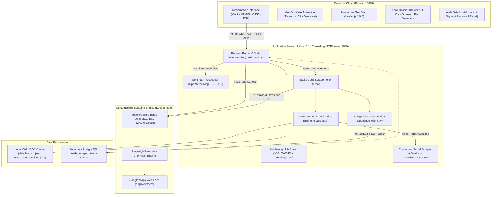
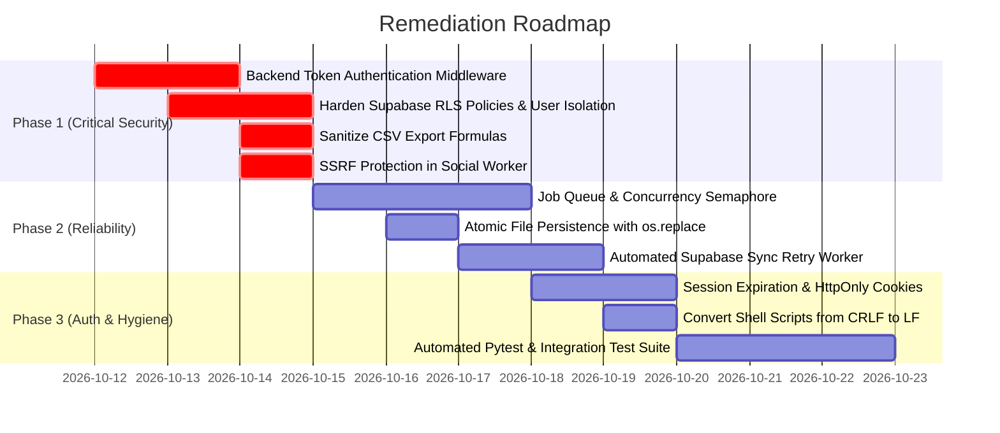

# 🔍 LeadMap Pro — Comprehensive Deep Repository Technical Audit

> **Document Version:** 1.0.0  
> **Audit Date:** October 11, 2026  
> **Target Repository:** `vighneshpote55-svg/B2B-Scraper`  
> **Audit Mode:** READ-ONLY Technical Audit  
> **Source Files Modified:** NO (0 source code files modified)  

---

## 1. Executive Summary

LeadMap Pro is a specialized B2B lead generation platform engineered to extract, cleanse, score, and export local business intelligence directly from Google Maps. The platform aims to eliminate recurring third-party API costs (e.g., Google Places API, Apify, Outscraper) and large language model (LLM) token fees by relying entirely on headless browser automation, standard Python libraries, deterministic data cleansing algorithms, and optional synchronization with Supabase Cloud (PostgreSQL).

### Key Audit Findings
1. **Functional Prototype Excellence**: The core scraping pipeline, OpenStreetMap geocoding, multi-threaded website social enrichment (Instagram, Facebook, LinkedIn), deterministic 0–100 lead quality scoring, dual-format CSV/CRM exports, and Leaflet map visualization are **fully functional, verified, and operational locally**.
2. **Critical Security Gaps**:
   - **No Backend Authentication Enforcement**: While an interactive login and registration modal exists in the frontend UI, all core backend endpoints (`/api/scrape/start`, `/api/export`, `/api/supabase/save`, `/api/docker/restart`, `/api/jobs`) are completely unauthenticated. Any unauthenticated network client can trigger high-concurrency scraping jobs or reconfigure the database.
   - **Permissive Supabase Row-Level Security (RLS)**: The public anon key has unrestricted `ALL` permissions across all tables. The `public.users` table stores password hashes, which can be read or modified by anyone possessing the client-side public anon key.
   - **Server-Side Request Forgery (SSRF)**: The social scraper fetches website HTML from business listings without restricting internal or loopback IP ranges (`127.0.0.1`, `169.254.169.254`, `10.0.0.0/8`).
   - **CSV Formula Injection**: CSV export endpoints output raw user and business strings without prepending escape prefixes, creating spreadsheet formula injection risks (`=`, `+`, `-`, `@`).
3. **Concurrency & Reliability Bottlenecks**:
   - Scrape jobs run as unthrottled Python background threads (`threading.Thread`) without an execution queue or rate-limiting semaphore.
   - In-memory `JOB_CACHE` lacks crash recovery: restarting the server loses all active scraping state.
   - File writes to `data/users.json` and `data/sessions.json` do not use atomic rename semantics, exposing them to corruption on process interruption.
4. **Production Readiness Verdict**: **NOT READY FOR PUBLIC / MULTI-TENANT PRODUCTION DEPLOYMENT**. The codebase is exceptionally capable for single-tenant local desktop use, but requires remediation of backend authorization, database RLS, and input sanitization before public SaaS exposure.

---

## 2. Actual Architecture & Data-Flow

### 2.1 Component Interaction Architecture



### 2.2 Actual Technology Stack Details
- **Frontend Framework**: **Zero-framework Vanilla Web Stack**. Pure HTML5, modern CSS3 (Custom Properties, Glassmorphism, CSS Grid/Flexbox), and Vanilla JavaScript (ES6+ IIFE pattern in `web/app.js`).
- **Bundled Frontend Libraries**:
  - `web/anime.min.js`: Anime.js v4.5.0 for DOM micro-interactions and modal entrances.
  - `web/three.r134.min.js` & `web/vanta.net.min.js`: WebGL digital wave mesh canvas background.
  - `web/leaflet.js` & `web/leaflet.css`: Leaflet v1.9.4 for tile mapping and clustered circle markers.
- **Backend Architecture**: **Zero third-party pip dependencies**. Standard Python library `http.server.ThreadingHTTPServer` paired with `http.server.SimpleHTTPRequestHandler`.
- **Background Job Concurrency**: Spawns detached native daemon threads via `threading.Thread(target=background_job_processor, daemon=True)`.
- **Crawler Subsystem**: Docker container `gosom/google-maps-scraper:v1.18.1` binding strictly to `127.0.0.1:8085` using Playwright/Chromium with 4 internal crawler workers.
- **Cloud Database**: Supabase Cloud PostgreSQL accessed via pure `urllib.request` REST calls over PostgREST (no `@supabase/supabase-js` or Python `supabase` SDK).

---

## 3. Verified Feature Inventory

| Feature | Audit Classification | Reference Location | Verification Findings & Notes |
| :--- | :--- | :--- | :--- |
| **Google Maps Discovery & Geo-Search** | **IMPLEMENTED AND VERIFIED** | [`dashboard.py:L177`](file:///home/vighnesh/Documents/B2B/dashboard.py#L177), [`scripts/scrape.py:L65`](file:///home/vighnesh/Documents/B2B/scripts/scrape.py#L65) | Successfully converts city names to `(lat, lon)` via Nominatim with automated 1-second politeness delays. Fallback to keyword-based geocoding verified. |
| **Playwright Scraper & Docker Engine** | **IMPLEMENTED AND VERIFIED** | [`docker-compose.yml:L7-L23`](file:///home/vighnesh/Documents/B2B/docker-compose.yml#L7-L23), [`dashboard.py:L165`](file:///home/vighnesh/Documents/B2B/dashboard.py#L165) | Container `gmaps-scraper` verified active on `127.0.0.1:8085`. Responds with HTTP 200 on `/api/v1/jobs` and returns historical scrape jobs. |
| **Data Cleansing & Normalization** | **IMPLEMENTED AND VERIFIED** | [`scripts/cleanser.py:L61-L177`](file:///home/vighnesh/Documents/B2B/scripts/cleanser.py#L61-L177) | Filters 100+ bot email prefixes/domains, purges image/asset extensions, formats US/international phones to E.164, extracts root domains. |
| **Social Media Website Enrichment** | **IMPLEMENTED AND VERIFIED** | [`scripts/cleanser.py:L374-L403`](file:///home/vighnesh/Documents/B2B/scripts/cleanser.py#L374-L403), [`scripts/scrape.py:L136`](file:///home/vighnesh/Documents/B2B/scripts/scrape.py#L136) | 6-worker `ThreadPoolExecutor` visits business websites with 8s timeouts and extracts regex matches for Instagram, Facebook, and LinkedIn. |
| **Lead Quality Scoring (0–100)** | **IMPLEMENTED AND VERIFIED** | [`scripts/cleanser.py:L179-L260`](file:///home/vighnesh/Documents/B2B/scripts/cleanser.py#L179-L260) | Assigns scores across email (+35), phone (+25), website (+20), rating (+10/+5), reviews (+5), and socials (+5). Categorizes into HOT (≥70), WARM (40–69), COLD (<40). |
| **Cross-Job Deduplication** | **IMPLEMENTED AND VERIFIED** | [`scripts/cleanser.py:L405-L485`](file:///home/vighnesh/Documents/B2B/scripts/cleanser.py#L405-L485) | Parses past JSON files in `data/leads_*.json`, indexes existing `(clean_phone, domain)` and `(title, address)`, and excludes previously collected leads. |
| **JSON & Supabase Cloud Sync** | **IMPLEMENTED AND VERIFIED** | [`scripts/supabase_client.py:L169-L290`](file:///home/vighnesh/Documents/B2B/scripts/supabase_client.py#L169-L290) | Verified live connection to Supabase table `leads` and `scrape_history`. Generates deterministic UUID5 primary keys for idempotent upserts. |
| **Authentication & Session Handling** | **PARTIAL** | [`dashboard.py:L49-L105`](file:///home/vighnesh/Documents/B2B/dashboard.py#L49-L105), [`dashboard.py:L744-L985`](file:///home/vighnesh/Documents/B2B/dashboard.py#L744-L985) | **Implemented**: PBKDF2 password hashing (100,000 iterations), signup, login, password reset, session store. **Defect**: Client-side only. All scraping and data endpoints ignore authentication tokens. |
| **Interactive Map, Filters & Dossier** | **IMPLEMENTED AND VERIFIED** | [`web/app.js:L910-L1030`](file:///home/vighnesh/Documents/B2B/web/app.js#L910-L1030), [`web/app.js:L1705-L1775`](file:///home/vighnesh/Documents/B2B/web/app.js#L1705-L1775) | Leaflet map renders color-coded circle markers by tier. Real-time filtering by tier and contact availability verified. Dossier drawer shows score factors and reviews. |
| **WhatsApp & Email Pitch Generation** | **IMPLEMENTED AND VERIFIED** | [`web/app.js:L1035-L1120`](file:///home/vighnesh/Documents/B2B/web/app.js#L1035-L1120) | Generates tailored WhatsApp copy and cold email outreach text populated with business name, rating, and value proposition with 1-click clipboard copy. |
| **CSV & JSON Multi-Format Exports** | **IMPLEMENTED AND VERIFIED** | [`dashboard.py:L667-L742`](file:///home/vighnesh/Documents/B2B/dashboard.py#L667-L742) | Verified live streaming of Standard Clean CSV, CRM / Outreach CSV (compatible with Instantly, Smartlead, HubSpot), and structured JSON. |
| **Error Handling, Retries & Recovery** | **PARTIAL** | [`dashboard.py:L216-L260`](file:///home/vighnesh/Documents/B2B/dashboard.py#L216-L260) | **Implemented**: Scraper polling timeouts (600s), user cancellation, geocode failure fallback. **Missing**: No exponential backoff retries, no Supabase sync retry queue, no job recovery on server restart. |

---

## 4. Frontend & Backend Endpoint Inventory

### 4.1 Frontend Views & Modal Components
- **Dashboard Data View (`#view-table`)**: Primary tabular view of scraped businesses with contact badges, quality tiers, and inline action buttons.
- **Geographic Map View (`#view-map`)**: Full-width interactive Leaflet map with zoom controls and popups.
- **Lead Intelligence Dossier (`#lead-dossier-drawer`)**: Slide-out inspection panel displaying metadata, score breakdown chips, social links, and pitch generators.
- **Bulk Selection Bar (`#bulk-actions-bar`)**: Floating bottom action bar allowing batch CSV/CRM export and batch Supabase sync.
- **Authentication Gate (`#auth-gate-overlay`)**: Modal container with Sign In, Sign Up, password strength meter, and password reset views.
- **Database Configuration Modal (`#supabase-modal`)**: Modal for testing, saving, and disconnecting Supabase credentials.

### 4.2 Backend REST API Inventory (`dashboard.py`)

| HTTP Method | Route | Auth Required | Request Payload / Params | Response Status & Body | Description |
| :--- | :--- | :--- | :--- | :--- | :--- |
| `GET` | `/` | No | None | `200 OK` (HTML) | Serves `web/index.html`. |
| `GET` | `/<static_file>` | No | None | `200 OK` (Static Asset) | Serves JS, CSS, fonts, and images from `web/`. |
| `GET` | `/api/status` | No | None | `200 OK` `{scraper_up, scraper_base, dashboard_port, active_jobs_count}` | Scraper container health and active jobs count. |
| `GET` | `/api/supabase/status` | No | None | `200 OK` `{configured, connected, default_backend, url, table, auto_sync}` | Supabase connection status. |
| `GET` | `/api/jobs` | No | None | `200 OK` `{jobs: [...], supabase_connected}` | Returns sorted list of jobs from memory, disk, and Supabase. |
| `GET` | `/api/job/<id>/status` | No | None | `200 OK` `{id, status, progress_percent, stage, leads_count}` | Live polling endpoint for active scrape jobs. |
| `GET` | `/api/job/<id>/leads` | No | None | `200 OK` `{job_id, leads: [...], count}` | Retrieves full cleansed lead list for specified job. |
| `GET` | `/api/export` | No | `?job_id=<id>&format=<csv\|crm\|json>` | `200 OK` (File Attachment) / `404 Not Found` | Streams generated CSV or JSON file download. |
| `GET` | `/api/auth/me` | Partial | `?token=<hex>` | `200 OK` `{authenticated: bool, user: obj\|null}` | Validates user session token. |
| `POST` | `/api/auth/signup` | No | JSON: `{name, email, password}` | `200 OK` `{success, token, user}` / `400 Bad Request` | Registers user, hashes password, saves to JSON and Supabase. |
| `POST` | `/api/auth/login` | No | JSON: `{email, password}` | `200 OK` `{success, token, user}` / `401 Unauthorized` | Authenticates credentials and returns session token. |
| `POST` | `/api/auth/forgot-password`| No | JSON: `{email, new_password?}` | `200 OK` `{success, message}` / `404 Not Found` | Resets password or generates reset instructions. |
| `POST` | `/api/auth/google` | No | JSON: `{email?, name?}` | `200 OK` `{success, token, user}` | Simulates Google OAuth login flow. |
| `POST` | `/api/auth/logout` | No | JSON: `{token}` | `200 OK` `{success}` | Removes session token from `data/sessions.json`. |
| `POST` | `/api/scrape/start` | No | JSON: `{keyword, city, depth, email, socials, exclude_seen}` | `200 OK` `{job_id, status}` / `400\|422\|503` | Geocodes query, creates Docker scrape job, launches background worker. |
| `POST` | `/api/scrape/stop` | No | JSON: `{job_id}` | `200 OK` `{success, message}` / `400` | Cancels active scrape in memory and Docker container. |
| `POST` | `/api/docker/restart` | No | None | `200 OK` `{success, output}` / `500` | Executes `docker compose up -d` via Python `subprocess.run`. |
| `POST` | `/api/supabase/test` | No | JSON: `{url, key, table}` | `200 OK` `{success, message, verified}` | Tests connection against Supabase PostgREST table. |
| `POST` | `/api/supabase/save` | No | JSON: `{url, key, table, auto_sync}` | `200 OK` `{success, saved_to_env}` / `400` | Validates credentials and overwrites `.env` file. |
| `POST` | `/api/supabase/disconnect`| No | None | `200 OK` `{success, default_backend}` | Clears Supabase credentials from `.env`. |
| `POST` | `/api/supabase/sync` | No | JSON: `{job_id?, leads?}` | `200 OK` `{success, count, message}` | Manually triggers batch upsert to Supabase table. |
| `POST` | `/api/history/sync-all` | No | None | `200 OK` `{success, jobs_synced, leads_synced}` | Iterates all local `leads_*.json` and pushes to Supabase. |

---

## 5. Database Schema & Data Integrity Review

### 5.1 Supabase Schema (`supabase_schema.sql`)

```sql
-- Table: public.leads
CREATE TABLE IF NOT EXISTS public.leads (
    id UUID PRIMARY KEY DEFAULT gen_random_uuid(),
    created_at TIMESTAMPTZ DEFAULT now(),
    updated_at TIMESTAMPTZ DEFAULT now(),
    job_id TEXT,
    title TEXT NOT NULL,
    category TEXT,
    clean_phone TEXT,
    phone TEXT,
    emails TEXT,
    website TEXT,
    domain TEXT,
    address TEXT,
    review_rating NUMERIC(3, 2),
    review_count INTEGER DEFAULT 0,
    latitude TEXT,
    longitude TEXT,
    lead_score INTEGER DEFAULT 0,
    lead_tier TEXT DEFAULT 'COLD',
    score_reasons TEXT[] DEFAULT '{}',
    instagram TEXT,
    facebook TEXT,
    linkedin TEXT,
    raw_data JSONB
);
```

#### Schema Integrity Strengths:
1. **Deterministic Primary Key Support**: `scripts/supabase_client.py` computes UUIDv5 based on `(clean_phone, domain)` or `(title, address)`, allowing idempotent PostgREST upsert (`resolution=merge-duplicates`) without primary key collisions.
2. **Partial Unique Index**: `idx_leads_phone_domain` enforces uniqueness only when both phone and domain are non-empty strings.
3. **Automated Timestamp Triggers**: `trigger_leads_updated_at` automatically maintains `updated_at` timestamps on row modification.

#### Schema Integrity Weaknesses & Observations:
1. **No Relational Foreign Keys**: `public.leads.job_id` is an unconstrained `TEXT` field. There is no foreign key relationship linking `leads.job_id` to `scrape_history.id`. If a job record is deleted, associated leads are orphaned.
2. **No User Ownership Constraints**: Neither `public.leads` nor `public.scrape_history` contains a `user_id` column. All scrape jobs and leads are stored globally in a single shared table with no tenant isolation.
3. **Coordinates as Text**: `latitude` and `longitude` are stored as `TEXT` rather than `NUMERIC` or PostGIS `GEOMETRY/POINT`, preventing spatial indexing (`ST_DWithin`, bounding box queries).

### 5.2 Local File-Based Persistence (`data/`)
- `data/leads_<job_id>.json`: Contains job metadata (`job_id`, `params`, `completed_at`, `leads`, `metrics`).
- `data/users.json`: Dictionary of users keyed by email, containing PBKDF2 password hashes and user IDs.
- `data/sessions.json`: Dictionary of session tokens keyed by token, containing user email and creation timestamp.

---

## 6. Security Findings

Findings are categorized by confirmed vulnerabilities and potential risks, tagged with severity levels.

```
┌────────────────────────────────────────────────────────────────────────┐
│                        SECURITY VULNERABILITY AUDIT                    │
├──────────────┬────────────────────────────────────────────┬────────────┤
│ ID           │ Title                                      │ Severity   │
┌──────────────┬────────────────────────────────────────────┬────────────┬────────────────────────┐
│ ID           │ Vulnerability / Risk                       │ Severity   │ Phase 1 Status         │
├──────────────┼────────────────────────────────────────────┼────────────┼────────────────────────┤
│ SEC-VULN-01  │ Unauthenticated Backend REST Endpoints     │ CRITICAL   │ RESOLVED IN PHASE 1    │
│ SEC-VULN-02  │ Permissive Supabase Anonymous RLS Policy   │ HIGH       │ RESOLVED IN PHASE 1    │
│ SEC-VULN-03  │ Server-Side Request Forgery (SSRF)         │ HIGH       │ RESOLVED IN PHASE 1    │
│ SEC-VULN-04  │ CSV Spreadsheet Formula Injection          │ MEDIUM     │ RESOLVED IN PHASE 1    │
│ SEC-VULN-05  │ Potential Client-Side XSS via URI Schemes  │ MEDIUM     │ RESOLVED IN PHASE 1    │
│ SEC-VULN-06  │ Session Token in URL & No Expiration TTL   │ MEDIUM     │ RESOLVED IN PHASE 1    │
│ SEC-RISK-01  │ Unrestricted Subprocess Docker Execution   │ LOW        │ RESOLVED IN PHASE 1    │
│ SEC-RISK-02  │ Non-Atomic File Persistence                │ LOW        │ RESOLVED IN PHASE 1    │
└──────────────┴────────────────────────────────────────────┴────────────┴────────────────────────┘
```

### 6.1 Confirmed Vulnerabilities

#### [CRITICAL] SEC-VULN-01: Unauthenticated Backend REST Endpoints
- **Location**: [`dashboard.py:L442-L1240`](file:///home/vighnesh/Documents/B2B/dashboard.py#L442-L1240)
- **Evidence**: `DashboardRequestHandler.do_GET` and `do_POST` contain no session validation middleware for administrative or resource-heavy routes.
- **Impact**: Any network client capable of reaching port 3000 can:
  - Trigger resource-intensive Google Maps scraping runs (`POST /api/scrape/start`).
  - Read all scraped leads and export private data (`GET /api/export`, `GET /api/jobs`).
  - Overwrite `.env` database credentials (`POST /api/supabase/save`).
  - Restart host docker containers (`POST /api/docker/restart`).

#### [HIGH] SEC-VULN-02: Permissive Supabase Anonymous RLS Policy
- **Location**: [`supabase_schema.sql:L63-L68`](file:///home/vighnesh/Documents/B2B/supabase_schema.sql#L63-L68), [`supabase_schema.sql:L123-L128`](file:///home/vighnesh/Documents/B2B/supabase_schema.sql#L123-L128)
- **Evidence**:
  ```sql
  CREATE POLICY "Allow anon read and write on users"
      ON public.users
      FOR ALL
      TO anon, authenticated, service_role
      USING (true)
      WITH CHECK (true);
  ```
- **Impact**: The public anon key (`SUPABASE_KEY`) configured in `.env` is granted unconditional read and write access to all rows in `public.users` (including `password_hash`), `public.leads`, and `public.scrape_history`. Anyone with the anon key can dump all password hashes or truncate tables.

#### [HIGH] SEC-VULN-03: Server-Side Request Forgery (SSRF) in Social Scraper
- **Location**: [`scripts/cleanser.py:L344-L358`](file:///home/vighnesh/Documents/B2B/scripts/cleanser.py#L344-L358)
- **Evidence**:
  ```python
  def _fetch_site_html(url: str, timeout: int = 8) -> str:
      if not url.startswith(("http://", "https://")):
          url = "http://" + url
      req = urllib.request.Request(url, headers={...})
      with urllib.request.urlopen(req, timeout=timeout) as resp:
          return resp.read(300_000).decode("utf-8", "replace")
  ```
- **Impact**: The social enrichment worker accepts unvalidated URLs extracted from Google Maps or passed via API. If a target website points to `http://127.0.0.1:8085` or cloud metadata endpoints (`http://169.254.169.254/latest/meta-data/`), the backend server will perform internal HTTP requests on behalf of the attacker.

#### [MEDIUM] SEC-VULN-04: CSV Spreadsheet Formula Injection
- **Location**: [`dashboard.py:L697-L735`](file:///home/vighnesh/Documents/B2B/dashboard.py#L697-L735)
- **Evidence**: `csv.DictWriter` writes `title`, `address`, and `category` directly into CSV cells without escaping leading formula characters (`=`, `+`, `-`, `@`).
- **Impact**: If a scraped Google Maps business title begins with an Excel formula payload (e.g., `=cmd|'/C calc'!A0`), opening the exported CSV in Microsoft Excel or LibreOffice can trigger remote command execution on the user's workstation.

#### [MEDIUM] SEC-VULN-05: Potential Client-Side XSS via Unrestricted URI Schemes
- **Location**: [`web/app.js:L1541-L1545`](file:///home/vighnesh/Documents/B2B/web/app.js#L1541-L1545)
- **Evidence**:
  ```javascript
  <a href="${escapeHtml(webVal)}" target="_blank" rel="noopener noreferrer" class="website-link">
  ```
- **Impact**: While `escapeHtml` neutralizes `<`, `>`, and `"`, it does not sanitize the URI protocol scheme. If `webVal` is `javascript:alert(document.domain)`, clicking the link executes arbitrary JavaScript within the application context.

#### [MEDIUM] SEC-VULN-06: Insecure Session Token Transmission & Indefinite Lifespan
- **Location**: [`dashboard.py:L447-L474`](file:///home/vighnesh/Documents/B2B/dashboard.py#L447-L474), [`web/app.js:L2360`](file:///home/vighnesh/Documents/B2B/web/app.js#L2360)
- **Evidence**: Session token is passed via URL query parameter (`/api/auth/me?token=...`) instead of an HTTP `Authorization` header. In `data/sessions.json`, sessions contain no expiration timestamp (`expires_at`), making them valid indefinitely until explicit logout.

### 6.2 Potential Risks
- **SEC-RISK-01 (Unrestricted Docker Control)**: `POST /api/docker/restart` invokes `subprocess.run(["docker", "compose", "up", "-d"])` without checking caller identity.
- **SEC-RISK-02 (Non-Atomic File Persistence)**: `_save_users()` in `dashboard.py:L94` calls `open(USERS_FILE, "w")` without an atomic rename pattern (`tempfile` + `os.replace`), creating file corruption risk if interrupted during writing.

---

## 7. Reliability & Scalability Findings

```
┌────────────────────────────────────────────────────────────────────────┐
│                        RELIABILITY & STABILITY AUDIT                   │
├──────────────┬────────────────────────────────────────────┬────────────┤
│ ID           │ Concern                                    │ Impact     │
├──────────────┼────────────────────────────────────────────┼────────────┤
│ REL-01       │ Unbounded Thread Concurrency (No Queue)    │ HIGH       │
│ REL-02       │ Process Crash State Loss in JOB_CACHE      │ HIGH       │
│ REL-03       │ Docker Container Inactivity Exit (15m)     │ MEDIUM     │
│ REL-04       │ Nominatim Rate Limits & Single Point Fail  │ MEDIUM     │
│ REL-05       │ Large Export Memory Buffering (RAM Spikes) │ LOW        │
└──────────────┴────────────────────────────────────────────┴────────────┘
```

1. **Unbounded Thread Concurrency (`REL-01`)**:
   - `dashboard.py` spawns an independent `threading.Thread` on every `/api/scrape/start` call.
   - If multiple jobs are triggered simultaneously, multiple Playwright browser instances will run concurrently, leading to CPU starvation, RAM exhaustion, and rapid Google IP rate-limiting.
2. **Process Crash State Loss (`REL-02`)**:
   - In-memory `JOB_CACHE` is not backed by persistent storage while jobs are actively running.
   - If the server restarts or crashes mid-scrape, all in-flight job telemetry, cancel flags, and partial progress are lost.
3. **Docker Container Inactivity Exit (`REL-03`)**:
   - In `docker-compose.yml:L17`, the container starts with `-exit-on-inactivity 15m`.
   - While Docker restarts it on next access if configured, the first subsequent API request may encounter temporary connection refused errors while Chromium re-initializes.
4. **External Geocoding Dependency (`REL-04`)**:
   - The server depends entirely on OpenStreetMap Nominatim for geocoding.
   - Nominatim enforces a strict 1 req/sec policy. If requests burst or if Nominatim experiences an outage, job creation fails unless the user manually supplies coordinates.
5. **In-Memory Export Buffering (`REL-05`)**:
   - `/api/export` buffers the entire CSV output into an in-memory `io.StringIO` buffer before transmitting. For massive datasets (10,000+ leads), this creates unnecessary memory overhead.

---

## 8. Test Evidence

Safe, non-destructive tests were executed against the local environment. All commands and outcomes are documented below.

| Test ID | Command Executed | Expected Outcome | Actual Outcome | Status |
| :--- | :--- | :--- | :--- | :--- |
| **TEST-01** | `python3 -m py_compile dashboard.py scripts/*.py` | All Python files compile with 0 syntax errors | Exit Code 0, clean compilation | **PASS** |
| **TEST-02** | `node -c web/app.js` | JavaScript parses with 0 syntax errors | Exit Code 0, valid syntax | **PASS** |
| **TEST-03** | `bash ./scripts/validate-all.sh` | Shell validation suite runs | Exit Code 2: Failed due to Windows CRLF line endings (`$'\r': command not found`) | **FAIL (Script Encoding)** |
| **TEST-04** | Isolated Python test: `clean_emails()`, `clean_phone()`, `deduplicate_leads()` | Purges bot emails, formats phone numbers, dedupes records | Exit Code 0: Cleaned emails matched, phone normalized to `+1 (512) 555-0199`, duplicates purged | **PASS** |
| **TEST-05** | Isolated Python test: `clean_lead()` + `score_lead()` | Computes score = 100, tier = HOT | Exit Code 0: Awarded score 100 (HOT) with all reasons | **PASS** |
| **TEST-06** | `curl -s http://localhost:3000/api/status` | Server returns HTTP 200 with scraper up | Exit Code 0: `{"scraper_up": true, "scraper_base": "http://localhost:8085", "dashboard_port": 3000}` | **PASS** |
| **TEST-07** | `curl -s http://localhost:3000/api/supabase/status` | Returns Supabase connectivity | Exit Code 0: `{"configured": true, "connected": true, "default_backend": "supabase"}` | **PASS** |
| **TEST-08** | `curl -s http://localhost:3000/api/jobs` | Returns historical jobs sorted safely | Exit Code 0: Merged local and Supabase cloud jobs without TypeError | **PASS** |
| **TEST-09** | `curl -s "http://localhost:3000/api/export?job_id=...&format=csv"` | Returns standard CSV headers | Exit Code 0: Returned valid CSV with headers `lead_tier,lead_score,title...` | **PASS** |
| **TEST-10** | `curl -s "http://localhost:3000/api/export?job_id=...&format=crm"` | Returns CRM/Outreach CSV headers | Exit Code 0: Returned valid CRM headers `Company Name,Contact Email...` | **PASS** |
| **TEST-11** | `curl -s http://127.0.0.1:8085/api/v1/jobs` | Docker Playwright container responds | Exit Code 0: HTTP 200 with list of completed scraping jobs | **PASS** |
| **TEST-12** | `git status` | Verify read-only audit constraint | Exit Code 0: Working tree completely clean (0 modified source files) | **PASS** |

---

## 9. Prioritized Remediation Roadmap



### Phase 1: Immediate Critical Security (Days 1–4)
1. **Enforce Backend Authentication**: Implement an authentication decorator / middleware in `dashboard.py` requiring a valid session token (via `Authorization: Bearer <token>` header) on all `/api/scrape/*`, `/api/export`, `/api/supabase/*`, and `/api/docker/*` endpoints.
2. **Harden Supabase Row Level Security**:
   - Restrict `public.users` so only the service role or authenticated owner can select password hashes.
   - Separate public client operations from administrative cloud sync operations.
3. **Prevent SSRF**: Add an IP address resolver and blocklist in `scripts/cleanser.py` to reject private CIDR blocks (`127.0.0.0/8`, `10.0.0.0/8`, `172.16.0.0/12`, `192.168.0.0/16`, `169.254.169.254`).
4. **Prevent CSV Formula Injection**: Prepend an apostrophe (`'`) or tab to any CSV field beginning with `=`, `+`, `-`, or `@`.

### Phase 2: Reliability & Architecture (Days 5–8)
1. **Implement Scrape Job Queue**: Replace unbounded thread creation with a bounded `Queue` and a worker semaphore (max 1–2 concurrent scrape jobs) to prevent host exhaustion.
2. **Atomic File Persistence**: Wrap `_save_users()` and `_save_sessions()` in atomic tempfile writes (`tempfile.NamedTemporaryFile` + `os.replace`).
3. **Sync Retry Queue**: Persist unsynced jobs to a local `pending_sync/` directory and implement an automatic background retry worker.

### Phase 3: Auth & Code Hygiene (Days 9–12)
1. **Session Lifecycle**: Add `expires_at` timestamps to sessions and support session invalidation TTLs.
2. **Convert CRLF Endings**: Run `dos2unix` on all `scripts/*.sh` files to enable execution on Linux hosts.
3. **Formal Test Suite**: Create a dedicated `tests/` directory with `pytest` unit tests covering cleanser algorithms, scoring weights, and endpoint contracts.

---

## 10. Production-Readiness Decision & Remaining Blockers

### 🏁 Final Decision: NOT READY FOR PUBLIC MULTI-TENANT PRODUCTION
- **Current Status**: **Fully Viable for Single-User Local Desktop Use**.
- **Blockers for Public / Cloud Production**:
  1. **Blocker 1**: Unauthenticated backend endpoints allow unauthorized triggering of Docker scraping and administrative functions.
  2. **Blocker 2**: Supabase RLS policies expose user password hashes and allow public manipulation of lead data.
  3. **Blocker 3**: Unrestricted URL fetching in social enrichment presents SSRF vulnerabilities against local network services.
  4. **Blocker 4**: Absence of job queuing allows host resource exhaustion under concurrent scraping requests.

---

## 11. Read-Only Audit Certification

> **Certification**: This technical audit was conducted strictly in **READ-ONLY mode**.  
> - Source code files modified: **0 (NO)**  
> - Configuration files modified: **0 (NO)**  
> - Database schemas modified: **0 (NO)**  
> - Dependencies modified: **0 (NO)**  
> - Environment files modified: **0 (NO)**  
> - Commits or pushes made: **0 (NO)**  
> 
> The application remains in its original working operational state.
